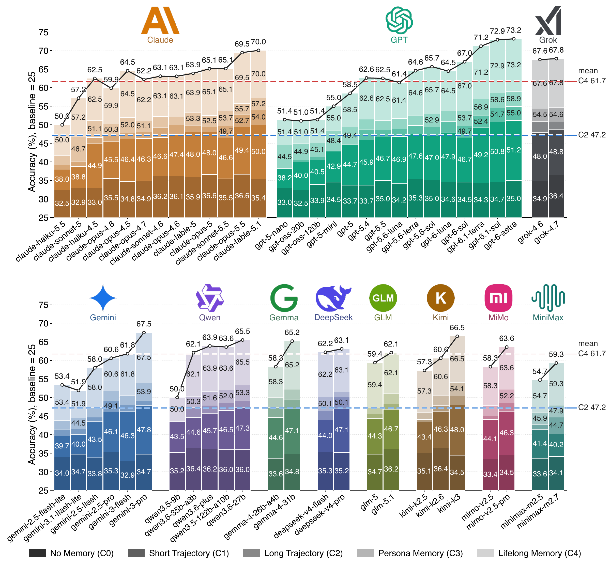
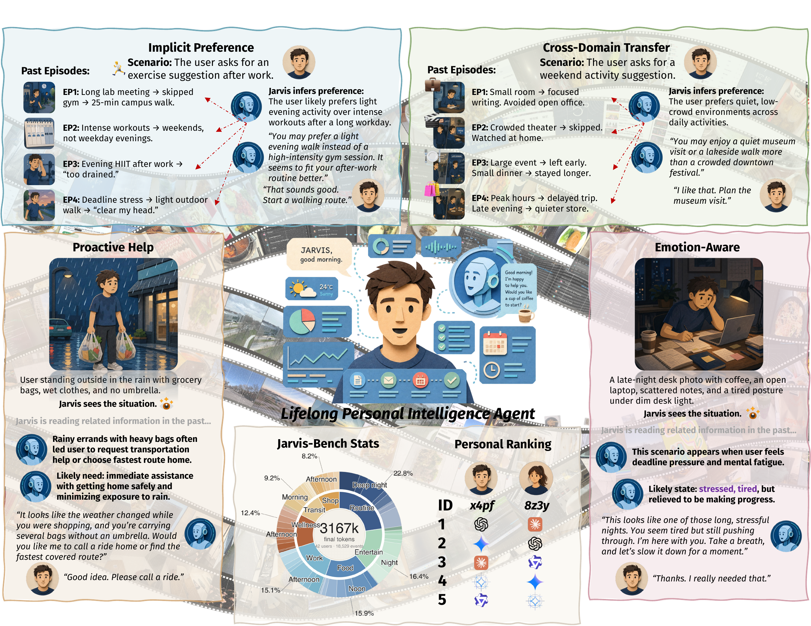
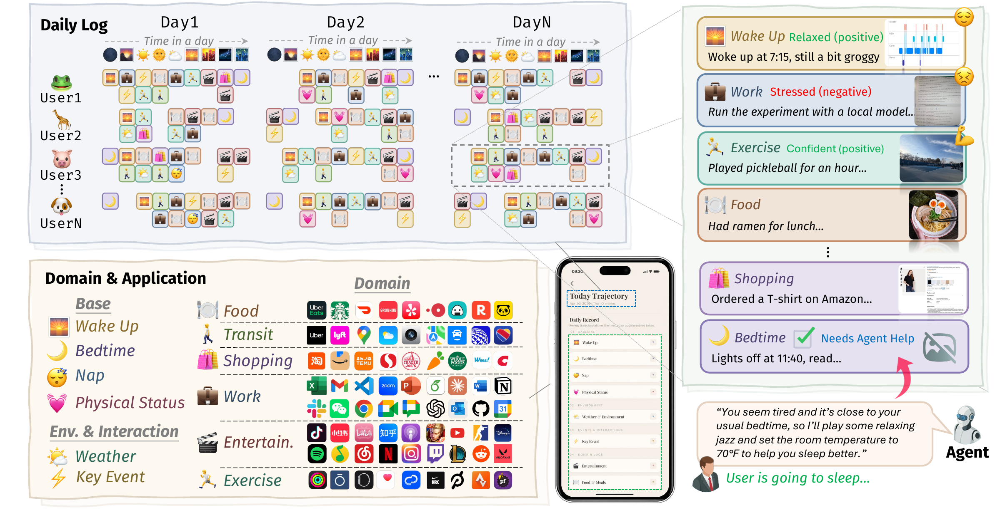

<h1 align="center"> JARVIS-Bench</h1>

<p align="center">
  <strong>Benchmarking Personal Intelligence Agents<br>on Long-Horizon Real-User Daily Traces</strong>
</p>

<p align="center">NeurIPS 2026 · Evaluations &amp; Datasets Track</p>

<p align="center">
  <a href="https://openreview.net/forum?id=yGQt9wAGkS">📄 Paper</a> ·
  <a href="https://agentmemoryworld.github.io/jarvis-bench/">🌐 Project Page</a> ·
  <a href="https://github.com/AgentMemoryWorld/JARVIS-Bench">GitHub</a> ·
  <a href="https://huggingface.co/datasets/WZDavid/JARVIS-Bench">🤗 Hugging Face</a>
</p>

<!-- Author affiliations: roster from the official project website. -->
<p align="center"><strong>Author affiliations</strong></p>

<p align="center"><sub>
  MatrAIx ·
  NVIDIA ·
  Google Research ·
  Meta ·
  Amazon ·
  Salesforce AI Research ·
  Capital One ·
  Roblox
</sub></p>
<!-- End author affiliations. -->

## Overview

Official code for **JARVIS-Bench**, a benchmark for evaluating personal intelligence agents on long-horizon real-user daily traces. It covers four tasks: implicit preference reasoning, proactive help prediction, emotion-aware modeling, and cross-domain transfer. The trajectories span 28 to 44 days per participant and combine real daily logs and images with synthetic expansions anchored to the collected records.

## Results

<a href="assets/figure-3-full.png"></a>

**Figure 3.** Implicit Preference Reasoning accuracy for 54 language models from 11 families under five memory conditions. Black lines trace C4 within each family; horizontal dashed lines indicate mean C2 and C4 accuracy. [High-resolution image](assets/figure-3-full.png) · [Vector PDF](assets/figure-3.pdf).

| Condition | Context available to the model |
| :--- | :--- |
| **C0: No Memory** | No user history or persona |
| **C1: Short Trajectory** | First 14 days of the user trajectory |
| **C2: Long Trajectory** | Full user trajectory |
| **C3: Persona Memory** | Full trajectory and structured persona profile |
| **C4: Lifelong Memory** | Full trajectory, persona, and distilled survey insights |

**C4 is an oracle condition:** it includes survey-derived preference information and is evaluated as an upper bound. Figure 3 reports preference reasoning accuracy, not a combined score over all four tasks.

## Tasks



**Figure 2.** Overview of Implicit Preference Reasoning, Proactive Help Prediction, Emotion-Aware Modeling, and Cross-Domain Transfer.

| Task | Evaluation setting | Metrics |
| :--- | :--- | :--- |
| **Implicit Preference Reasoning** | Answer 100 four-option survey questions under C0 to C4 | Accuracy |
| **Proactive Help Prediction** | Predict assistance needs and provide a rationale; text and image variants | Precision, recall, F1, rationale match rate |
| **Emotion-Aware Modeling** | Predict emotional polarity and mood from event context; text and image variants | Polarity accuracy, mood F1 |
| **Cross-Domain Transfer** | Remove one domain or retain a single domain in the trajectory | Same-domain accuracy change relative to C2 or C0, respectively |

The evaluation pools differ by task. Proactive Help Prediction and Emotion-Aware Modeling each report results for 10 models on 15 eligible participants; the 54-model comparison in Figure 3 concerns Implicit Preference Reasoning.

## Data



**Figure 1.** Daily activity logging and participant feedback used to construct the benchmark. Real observations are retained as anchors for synthetic trajectory expansion. The final evaluated dataset contains 18,471 events after deduplication; the raw count displayed in Figure 2 is 18,529.

- **[Hugging Face](https://huggingface.co/datasets/WZDavid/JARVIS-Bench)**

Data is distributed under **CC BY-NC 4.0** and downloaded separately from the code. See the [data setup guide](docs/USAGE.md#obtaining-the-data) for the expected directory structure and per-task requirements.

## Quick Start

```bash
git clone https://github.com/AgentMemoryWorld/JARVIS-Bench.git
cd JARVIS-Bench
pip install datasets
```

```python
from datasets import load_dataset

events = load_dataset("WZDavid/JARVIS-Bench", "events", split="full")
days = load_dataset("WZDavid/JARVIS-Bench", "days", split="full")
profiles = load_dataset("WZDavid/JARVIS-Bench", "profiles", split="full")
```

For model evaluation, follow the [usage guide](docs/USAGE.md) for the expected input layout, task requirements, and commands. Provider settings are in [`eval/configs/models.yaml`](eval/configs/models.yaml).

- [Usage guide](docs/USAGE.md): data preparation, task variants, domain ablations, and result aggregation.
- [Evaluation reference](eval/README.md): CLI options, memory conditions, caching, and parallel execution.

## Repository Structure

```text
JARVIS-Bench/
├── assets/                 # Paper figures and project logo
├── docs/USAGE.md            # Data setup and usage guide
├── eval/                   # Evaluation pipeline, prompts, and model configs
├── ground_truth/           # Survey answer keys
├── JarvisBench_problem.csv # Survey questions
└── tools/prepare_data.py    # Arrange prepared evaluation inputs
```

## Citation

If you use JARVIS-Bench in your research, please cite the paper.

<details>
<summary>BibTeX</summary>

```bibtex
@inproceedings{zhang2026jarvisbench,
  title     = {{JARVIS-Bench}: Benchmarking Personal Intelligence Agents on Long-Horizon Real-User Daily Traces},
  author    = {Zhang, Weizhi and
               Huang, Wei-Chieh and
               Liang, Yueqing and
               Jiang, Liwei and
               Wang, Zhengxiang and
               Yang, Liangwei and
               Li, Zechen and
               Wu, Yuchen and
               Zhang, Haozhen and
               Wang, Yu and
               Bei, Yuanchen and
               Zhou, Yue and
               Zhu, Siqi and
               Zou, Henry Peng and
               Liu, Jiahong and
               Zhang, Xinni and
               Martin, Paul and
               Imperial, Joseph Marvin and
               Luo, Yuyang and
               Xu, Xiongxiao and
               Huang, Baixiang and
               Wu, Shanglin and
               Resck, Lucas and
               Wang, Yibo and
               Liu, Yuqing and
               He, Langzhou and
               Li, Chengze and
               Tian, Yuxin and
               Zheng, Kening and
               Ma, Enze and
               Huynh, Boi and
               Hui, Zheng and
               Yang, Rui and
               Feng, Tao and
               Yang, Jie and
               Li, Shanghao and
               Wang, Haoran and
               Yang, Wooseong and
               Zhang, Hanrong and
               Ma, Huanhuan and
               Yoon, Daye and
               Wu, Yaozu and
               Lian, Shikan and
               Ruan, Xiaoqian and
               Wang, Fangxin and
               Park, Hyeonjeong and
               Hu, Hins and
               Fan, Wenzhe and
               Wang, Chen and
               Wang, Yifan and
               Huang, Jintao and
               Wang, Yijun and
               Wang, Haixin and
               Wu, Yating and
               Qian, Cheng and
               Gu, Yifan and
               Li, Dongyuan and
               Wang, Song and
               Caliskan, Aylin and
               Wang, Jindong and
               Luo, Xiao and
               Chen, Yankai and
               Shu, Kai and
               Liu, Xue and
               Hao, Yuexing and
               Li, Xiaomin and
               Yu, Philip S.},
  booktitle = {Advances in Neural Information Processing Systems (NeurIPS), Track on Evaluations and Datasets},
  year      = {2026},
  url       = {https://openreview.net/forum?id=yGQt9wAGkS}
}
```

</details>

## License

Code: [MIT](LICENSE). Data: [CC BY-NC 4.0](https://huggingface.co/datasets/WZDavid/JARVIS-Bench).
